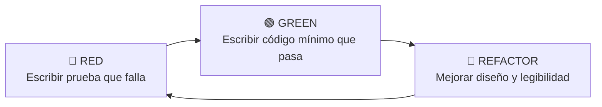

# Práctica de TDD — Desarrollo Guiado por Pruebas

**Asignatura:** Construcción de Software  
**Institución:** Universidad Continental  
**Semana:** 10  
**Docente:** Ing. Henderson Nozart Gibaja Reyes  

---

## 1. ¿Qué es TDD (Test-Driven Development)?

**TDD (Test-Driven Development)** es una metodología y disciplina de diseño y desarrollo de software donde las **pruebas automatizadas se escriben ANTES del código de producción**.

En lugar de escribir la lógica y probarla después de forma manual o reactiva, TDD guía la implementación a través de iteraciones cortas y estructuradas conocidas como el **ciclo Red-Green-Refactor**:



1. **🔴 Red (Rojo):** Se escribe una prueba unitaria para un requisito específico. Se ejecuta la prueba y **debe fallar**, ya sea porque la función no existe o porque aún no implementa el comportamiento esperado. Esto garantiza que la prueba realmente valida el requisito y no da falsos positivos.
2. **🟢 Green (Verde):** Se escribe la cantidad **mínima e indispensable** de código en producción para que la prueba pase exitosamente.
3. **🔵 Refactor (Refactorizar):** Se limpia, reestructura y optimiza el código (eliminando duplicación, mejorando nombres, añadiendo tipado y docstrings) asegurando en todo momento que todas las pruebas automatizadas continúen pasando en verde.

---

## 2. Estructura del Proyecto

```text
tdd-practica/
├── fizzbuzz/
│   ├── __init__.py
│   ├── fizzbuzz.py            # Implementación de la función fizzbuzz(n)
│   └── test_fizzbuzz.py       # Pruebas unitarias de FizzBuzz
├── validador/
│   ├── __init__.py
│   ├── validador.py           # Implementación de validar_password(pwd)
│   └── test_validador.py      # Pruebas unitarias del Validador
├── .gitignore                 # Exclusión de __pycache__ y archivos compilados
└── README.md                  # Documentación del proyecto y proceso TDD
```

---

## 3. Proceso de Implementación TDD

### Ejercicio 1 — FizzBuzz (`fizzbuzz/`)

La función `fizzbuzz(n: int) -> str` recibe un entero y retorna:
- `"Fizz"` si `n` es divisible por 3.
- `"Buzz"` si `n` es divisible por 5.
- `"FizzBuzz"` si `n` es divisible por 3 y por 5.
- `str(n)` en cualquier otro caso.

#### Ciclos ejecutados:
- **Ciclo 1 (Números normales):**
  - **Red:** Se creó `test_numero_normal` esperando `"1"`, `"2"`, `"4"`. Falló por ausencia de la función.
  - **Green:** Se implementó `return str(n)`. Pruebas pasaron.
- **Ciclo 2 (Fizz - Múltiplos de 3):**
  - **Red:** Se agregó `test_fizz` evaluando 3, 6, 9. Falló con `AssertionError: '3' != 'Fizz'`.
  - **Green:** Se añadió `if n % 3 == 0: return "Fizz"`.
- **Ciclo 3 (Buzz - Múltiplos de 5):**
  - **Red:** Se agregó `test_buzz` evaluando 5 y 10. Falló con `AssertionError: '5' != 'Buzz'`.
  - **Green:** Se añadió `if n % 5 == 0: return "Buzz"`.
- **Ciclo 4 (FizzBuzz - Múltiplos de 3 y 5):**
  - **Red:** Se agregó `test_fizzbuzz` evaluando 15 y 30. Falló porque retornaba `"Fizz"` (al evaluar primero `% 3`).
  - **Green:** Se antepuso la condición `if n % 15 == 0: return "FizzBuzz"`.
- **Ciclo 5 (Refactor y test integral con `subTest`):**
  - Se agregó `test_rango_completo` con un diccionario exhaustivo evaluado mediante `self.subTest(n=n)`.
  - Se añadieron docstrings y anotaciones de tipo (`int -> str`).

---

### Ejercicio 2 — Validador de Contraseñas (`validador/`)

La función `validar_password(pwd: str) -> dict` evalúa una contraseña y retorna:
```python
{
    "valida": True | False,
    "errores": ["lista de errores encontrados"]
}
```

Reglas implementadas incrementalmente:
1. Longitud mínima de 8 caracteres (`"Mínimo 8 caracteres"`).
2. Al menos una letra mayúscula (`"Al menos una mayúscula"`).
3. Al menos una letra minúscula (`"Al menos una minúscula"`).
4. Al menos un dígito numérico (`"Al menos un dígito"`).
5. Al menos un carácter especial del conjunto `!@#$%^&*` (`"Al menos un carácter especial"`).

#### Ciclos ejecutados:
- **Ciclo 1 (Longitud mínima):**
  - **Red:** Se escribieron `test_password_muy_corta` y `test_password_longitud_ok`. Falló por ausencia de función.
  - **Green:** Validación de `len(pwd) < 8`.
- **Ciclo 2 (Mayúscula):**
  - **Red:** Se escribió `test_sin_mayuscula`. Falló (`AssertionError: True is not false`).
  - **Green:** Validación con `any(c.isupper() for c in pwd)`.
- **Ciclo 3 (Minúscula):**
  - **Red:** Se escribió `test_sin_minuscula`. Falló.
  - **Green:** Validación con `any(c.islower() for c in pwd)`.
- **Ciclo 4 (Dígito):**
  - **Red:** Se escribió `test_sin_digito`. Falló.
  - **Green:** Validación con `any(c.isdigit() for c in pwd)`.
- **Ciclo 5 (Carácter especial):**
  - **Red:** Se escribió `test_sin_caracter_especial` sin caracteres de `!@#$%^&*`. Falló.
  - **Green:** Validación con `any(c in CARACTERES_ESPECIALES for c in pwd)`.
- **Ciclo 6 (Refactor y test integral):**
  - Se añadieron `test_password_valida_completa`, `test_multiples_errores` y `test_varios_passwords_con_subTest`.
  - Refactorización del código extrayendo la constante `CARACTERES_ESPECIALES`, tipado estricto con `typing.Any` y documentación detallada.

---

## 4. Ejecución de las Pruebas

Para ejecutar todas las pruebas del proyecto automáticamente:

```bash
# Estando dentro de la carpeta tdd-practica:
python -m unittest discover -v
```

Para ejecutar las pruebas de cada módulo individualmente:

```bash
# Pruebas de FizzBuzz
python -m unittest fizzbuzz/test_fizzbuzz.py -v

# Pruebas del Validador de Contraseñas
python -m unittest validador/test_validador.py -v
```

### Resultado esperado:
```text
test_buzz (fizzbuzz.test_fizzbuzz.TestFizzBuzz.test_buzz) ... ok
test_fizz (fizzbuzz.test_fizzbuzz.TestFizzBuzz.test_fizz) ... ok
test_fizzbuzz (fizzbuzz.test_fizzbuzz.TestFizzBuzz.test_fizzbuzz) ... ok
test_numero_normal (fizzbuzz.test_fizzbuzz.TestFizzBuzz.test_numero_normal) ... ok
test_rango_completo (fizzbuzz.test_fizzbuzz.TestFizzBuzz.test_rango_completo) ... ok
test_multiples_errores (validador.test_validador.TestValidarPassword.test_multiples_errores) ... ok
test_password_longitud_ok (validador.test_validador.TestValidarPassword.test_password_longitud_ok) ... ok
test_password_muy_corta (validador.test_validador.TestValidarPassword.test_password_muy_corta) ... ok
test_password_valida_completa (validador.test_validador.TestValidarPassword.test_password_valida_completa) ... ok
test_sin_caracter_especial (validador.test_validador.TestValidarPassword.test_sin_caracter_especial) ... ok
test_sin_digito (validador.test_validador.TestValidarPassword.test_sin_digito) ... ok
test_sin_mayuscula (validador.test_validador.TestValidarPassword.test_sin_mayuscula) ... ok
test_sin_minuscula (validador.test_validador.TestValidarPassword.test_sin_minuscula) ... ok
test_varios_passwords_con_subTest (validador.test_validador.TestValidarPassword.test_varios_passwords_con_subTest) ... ok

----------------------------------------------------------------------
Ran 14 tests in 0.001s

OK
```

---

## 5. Historial de Commits TDD

El repositorio cuenta con commits incrementales que evidencian la aplicación rigurosa de cada fase Red→Green→Refactor:

```text
* Validador Ciclo 6: Refactor y tests integrales con subTest
* Validador Ciclo 5: validación de carácter especial (Red→Green)
* Validador Ciclo 4: validación de dígito (Red→Green)
* Validador Ciclo 3: validación de minúscula (Red→Green)
* Validador Ciclo 2: validación de mayúscula (Red→Green)
* Validador Ciclo 1: validación de longitud mínima (Red→Green)
* Ciclo 5: Refactor y test con subTest para FizzBuzz
* Ciclo 4: múltiplos de 3 y 5 retornan FizzBuzz (Red→Green)
* Ciclo 3: múltiplos de 5 retornan Buzz (Red→Green)
* Ciclo 2: múltiplos de 3 retornan Fizz (Red→Green)
* Agregar .gitignore para excluir __pycache__ y archivos compilados
* Ciclo 1: números normales (Red→Green)
* Estructura inicial del proyecto TDD
```

---

## 6. Instrucciones para subir a GitHub

Para vincular este repositorio local a GitHub y enviarlo:

1. Crear un nuevo repositorio en [GitHub](https://github.com/new) con el nombre `tdd-practica` (sin inicializar con README ni .gitignore).
2. Ejecutar los siguientes comandos en la terminal dentro de `tdd-practica`:

```bash
git remote add origin https://github.com/<TU_USUARIO>/tdd-practica.git
git branch -M main
git push -u origin main
```
